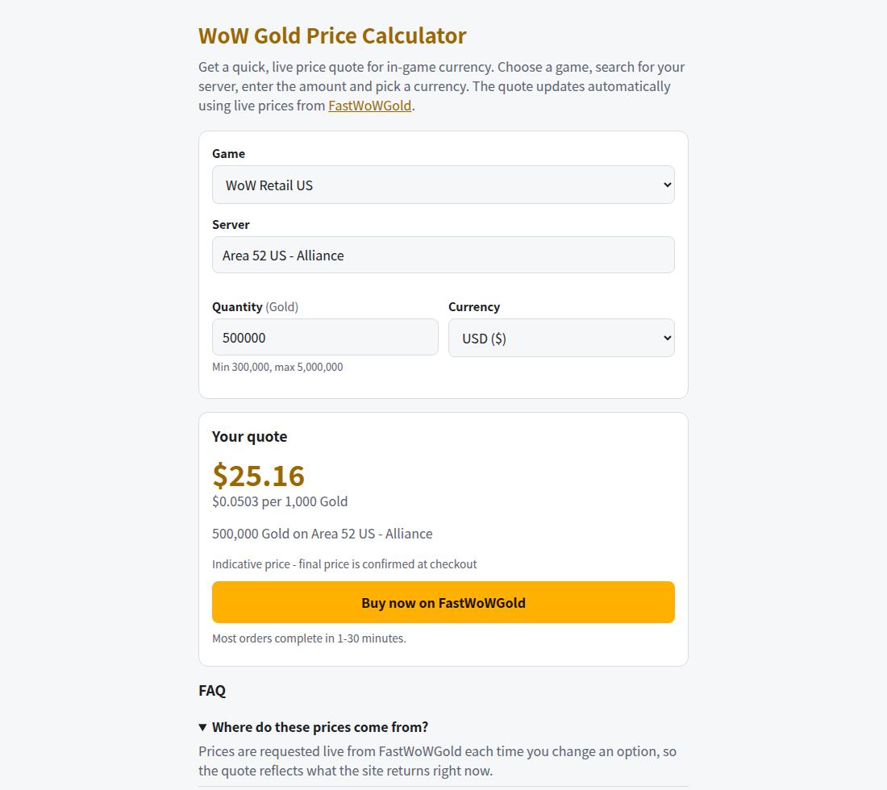

# WoW Gold Calculator

A free, static game currency price calculator. Pick a game, server, quantity and currency to get a live indicative quote from [FastWoWGold](https://fastwowgold.com).

Live demo: <https://fastwowgold.github.io/wow-gold-calculator/>

Comparing with the WoW Token? See the [WoW Token price calculator](https://fastwowgold.com/wow-token-price-calculator), which puts the live token price next to FastWoWGold's price for Retail US and EU.

[](https://fastwowgold.github.io/wow-gold-calculator/)

Developer? The same API is wrapped in a tiny npm package: [@fastwowgold/quote](https://www.npmjs.com/package/@fastwowgold/quote) ([source](https://github.com/FastWowGold/fastwowgold-quote)).

## How it works

Plain HTML, CSS and vanilla JS. No build step, no dependencies, no secrets. The page calls FastWoWGold's public read-only JSON API:

- `GET /api/v1/catalog` for games and currencies
- `GET /api/v1/games/{id}?q=...&limit=50` for server search
- `POST /api/v1/quote` for the price

Only the quote total is shown, plus a per-unit figure computed in the browser. The API prices card payment by default (card processing fee included), so the page says so under the price and names the cheaper methods for USD and CAD. The result is indicative; the final price is confirmed at checkout. Selections are remembered in `localStorage` and mirrored in the URL hash, so a quote can be shared.

## Run locally

```
python3 -m http.server
```

Then open `http://localhost:8000/`. To test against a local API, add the `api` query parameter:
`http://localhost:8000/?api=http://localhost:5213`

## Deploy on GitHub Pages

1. Push these files to a GitHub repository.
2. In the repository, open Settings > Pages.
3. Set the source to the main branch, root folder, and save.
4. If you fork it under another account, update the canonical URL in `index.html` and the demo link above.

## License

MIT, see [LICENSE](LICENSE).

---

Powered by [FastWoWGold](https://fastwowgold.com).
